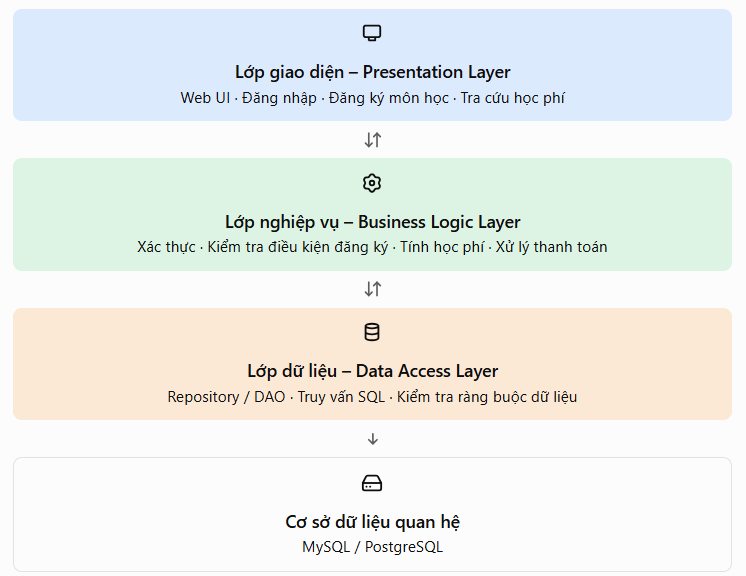
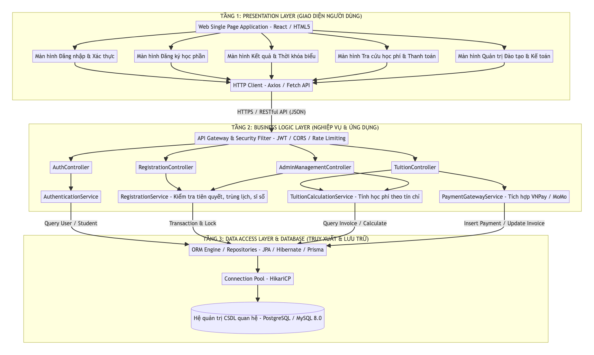
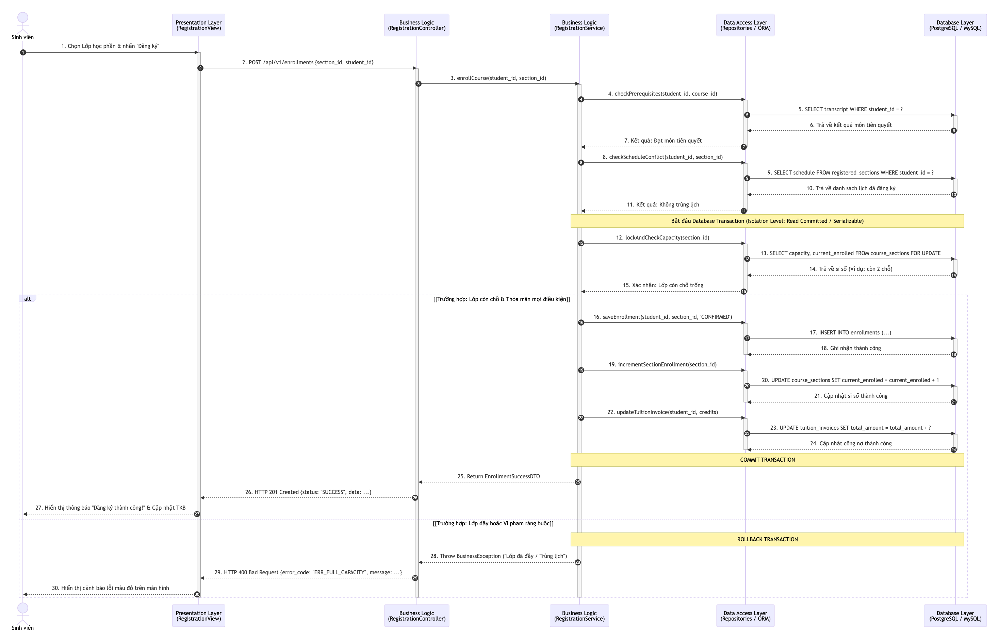
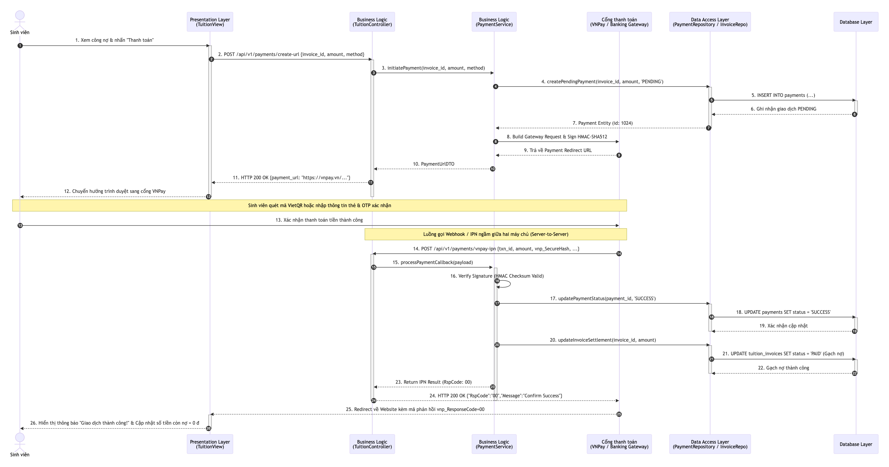

# Thiết kế kiến trúc

> Trích từ báo cáo thiết kế Buổi 6 (Lab06) – Nhóm Ba Anh Tài.

### 2.1. Lựa chọn mô hình kiến trúc
Đối với đề tài **Quản lý việc đăng ký môn học và thu học phí của sinh viên**, nhóm quyết định lựa chọn **Mô hình kiến trúc 3 lớp (3-Tier Architecture)** kết hợp với phong cách thiết kế **RESTful API** và kiến trúc **MVC (Model - View - Controller)** ở tầng ứng dụng.

Kiến trúc 3 lớp phân chia toàn bộ hệ thống phần mềm thành ba tầng vật lý/logic độc lập và phân cấp rõ ràng:
1. **Lớp giao diện (Presentation Tier):** Chịu trách nhiệm hiển thị dữ liệu đồ họa, tiếp nhận tương tác của người dùng (sinh viên, cán bộ quản lý) và gửi các yêu cầu dịch vụ xuống tầng dưới.
2. **Lớp nghiệp vụ (Business Logic Tier / Application Tier):** Đóng vai trò "bộ não" trung tâm điều phối toàn bộ hệ thống, xử lý mọi quy tắc học vụ (kiểm tra tiên quyết, tính số tín chỉ, phát hiện trùng lịch, kiểm soát sĩ số) và tính toán công nợ học phí.
3. **Lớp truy cập và lưu trữ dữ liệu (Data Access & Database Tier):** Chịu trách nhiệm tương tác trực tiếp với hệ quản trị cơ sở dữ liệu quan hệ (RDBMS), thực hiện các câu lệnh truy vấn, đọc, ghi và bảo toàn tính toàn vẹn dữ liệu.

Sự kết hợp giữa 3-Tier và RESTful API cho phép tách rời hoàn toàn giữa ứng dụng giao diện phía trước (Frontend Client) và dịch vụ xử lý nghiệp vụ phía sau (Backend Services), giao tiếp thông qua giao thức chuẩn HTTP/HTTPS với định dạng dữ liệu nhẹ **JSON (JavaScript Object Notation)**.

---

### 2.2. Sơ đồ kiến trúc tổng thể

#### 2.2.1. Hình ảnh kiến trúc 3 lớp chuẩn hóa
Dưới đây là sơ đồ minh họa nguyên lý phân tầng của kiến trúc 3 lớp áp dụng cho hệ thống:

#### 2.2.2. Sơ đồ kiến trúc tổng thể chi tiết hệ thống
Dưới đây là hình ảnh sơ đồ kiến trúc mở rộng, mô tả chi tiết các module chức năng, công nghệ áp dụng và các kênh giao tiếp liên tầng của hệ thống Quản lý đăng ký môn học và thu học phí:

---

### 2.3. Mô tả trách nhiệm từng lớp

#### 2.3.1. Lớp giao diện (Presentation Layer)
* **Đối tượng phục vụ:** Sinh viên, Cán bộ phòng đào tạo, Nhân viên phòng kế toán và Quản trị viên hệ thống.
* **Nhiệm vụ cốt lõi:**
  - Kết xuất giao diện người dùng trực quan, thích ứng đa thiết bị (Responsive Web UI) bằng HTML5, CSS3, và JavaScript Framework hiện đại (như React hoặc Vue.js).
  - Tiếp nhận các thao tác đầu vào: sự kiện click chọn lớp học phần, bộ lọc tìm kiếm theo học kỳ/khoa, thông tin đăng nhập, xác nhận thanh toán.
  - **Client-side Validation:** Kiểm tra tính hợp lệ cơ bản của dữ liệu nhập phía người dùng (kiểm tra định dạng email, mã sinh viên, mật khẩu không được rỗng) trước khi gửi yêu cầu lên máy chủ, giúp tiết kiệm băng thông và phản hồi nhanh cho người dùng.
  - Đóng gói dữ liệu yêu cầu vào các gói tin HTTP (GET, POST, PUT, DELETE) với payload JSON và tiêu đề bảo mật (Bearer Authorization Token).
  - Phân tích phản hồi từ tầng nghiệp vụ và kết xuất trạng thái trực quan: thông báo thành công (Success Toast), hiển thị hộp thoại cảnh báo lỗi cụ thể (Error Dialog: "Lớp đã đầy", "Trùng lịch học", "Chưa đạt môn tiên quyết").

#### 2.3.2. Lớp nghiệp vụ (Business Logic Layer)
* **Vị trí và vai trò:** Là trung tâm xử lý của toàn bộ hệ thống, triển khai trên nền tảng ứng dụng máy chủ (như Spring Boot / Node.js / ASP.NET Core).
* **Nhiệm vụ cốt lõi:**
  - **Xác thực và Phân quyền (Authentication & Authorization):** Xác minh danh tính người dùng thông qua cơ chế mã hóa mật khẩu (BCrypt) và cấp phát chuỗi chứng thực số **JWT (JSON Web Token)**. Kiểm soát quyền truy cập chi tiết dựa trên vai trò (Role-Based Access Control - RBAC: `ROLE_STUDENT`, `ROLE_ACADEMIC_ADMIN`, `ROLE_ACCOUNTANT`).
  - **Xử lý đăng ký học phần:** 
    + Kiểm tra trạng thái mở của đợt đăng ký (`is_open`).
    + Thẩm định điều kiện môn học tiên quyết bằng cách truy vết lịch sử điểm của sinh viên.
    + Thẩm định giới hạn số tín chỉ tối đa cho phép trong học kỳ ($12 \le \text{Credits} \le 24$).
    + Kiểm tra xung đột lịch học: đối chiếu thứ và ca học của lớp đang chọn với toàn bộ các lớp sinh viên đã đăng ký thành công trong kỳ.
    + **Kiểm soát sức chứa đồng thời (Concurrency Control):** Quản lý giao dịch ghi danh, đảm bảo không có trường hợp 2 sinh viên cùng được nhận khi lớp chỉ còn đúng 1 vị trí trống.
  - **Tính toán học phí và Quản lý tài chính:**
    + Tự động nhân tổng số tín chỉ đăng ký với đơn giá quy định của học kỳ để phát sinh số tiền học phí phải nộp.
    + Khởi tạo hóa đơn học phí (`TuitionInvoice`) và gán hạn chót thanh toán (`due_date`).
    + Tích hợp với cổng thanh toán điện tử (VNPay, MoMo, VietQR): tạo chuỗi thanh toán, tạo mã chữ ký kiểm tra (Secure Hash / Checksum), xác thực thông báo giao dịch (Webhook / IPN Callback), và thực hiện cơ chế gạch nợ tự động.

#### 2.3.3. Lớp truy cập dữ liệu (Data Access Layer - DAL)
* **Vị trí và vai trò:** Là lớp trung gian ngăn cách giữa tầng nghiệp vụ và hệ thống cơ sở dữ liệu vật lý.
* **Nhiệm vụ cốt lõi:**
  - Áp dụng các mẫu thiết kế hướng dữ liệu như **Repository Pattern** hoặc **Data Access Object (DAO)** để trừu tượng hóa các thao tác cơ sở dữ liệu.
  - Thực thi các câu lệnh truy vấn dữ liệu (CRUD - Create, Read, Update, Delete) thông qua công cụ ánh xạ đối tượng - quan hệ (**ORM** như Hibernate/JPA hoặc Prisma) hoặc các truy vấn SQL thuần tối ưu hóa.
  - **Quản lý giao dịch (Transaction Management):** Đảm bảo các chuỗi thao tác gồm nhiều bước (ví dụ: tạo bản ghi đăng ký + tăng sĩ số lớp học phần + cập nhật công nợ học phí) được thực thi trong một khối thống nhất (`@Transactional`). Nếu có bất kỳ bước nào thất bại, hệ thống tự động hoàn tác toàn bộ (`ROLLBACK`) để giữ dữ liệu không bị sai lệch.
  - **Tối ưu hóa kết nối:** Sử dụng cơ chế hồ bơi kết nối (**Connection Pooling** như HikariCP) để tái sử dụng các kết nối mở sẵn đến CSDL, giảm độ trễ thiết lập kết nối và tăng khả năng phục vụ đồng thời.

#### 2.3.4. Cơ sở dữ liệu quan hệ (Database Layer)
* **Công nghệ sử dụng:** Hệ quản trị CSDL quan hệ chuẩn công nghiệp (MySQL 8.0+ hoặc PostgreSQL 15+).
* **Nhiệm vụ cốt lõi:**
  - Lưu trữ bền vững (Persistent Storage) toàn bộ các bảng dữ liệu cốt lõi: người dùng, sinh viên, môn học, học kỳ, lớp học phần mở, đăng ký học phần, hóa đơn học phí và lịch sử thanh toán.
  - Thực thi các ràng buộc cấp CSDL: Khóa chính (Primary Key), Khóa ngoại (Foreign Key), Ràng buộc duy nhất (Unique Constraints), Ràng buộc kiểm tra miền giá trị (Check Constraints).
  - Tối ưu hóa tốc độ truy xuất thông qua hệ thống chỉ mục (B-Tree Indexes) trên các trường thường xuyên tìm kiếm và liên kết bảng.

---

### 2.4. Mô tả luồng xử lý nghiệp vụ đăng ký học phần

Nghiệp vụ Đăng ký học phần là chức năng phức tạp và quan trọng nhất của hệ thống, đòi hỏi sự phối hợp nhịp nhàng giữa cả 3 lớp.

#### 2.4.1. Quy trình các bước thực thi
1. **Bước 1 (Giao diện):** Sinh viên chọn học kỳ, tìm kiếm và tick chọn lớp học phần mong muốn trên giao diện `RegistrationView`, sau đó nhấn nút **"Đăng ký"**. Giao diện thu thập `student_id` và `section_id`, gửi yêu cầu `POST /api/v1/enrollments` kèm JWT Token xuống tầng nghiệp vụ.
2. **Bước 2 (Kiểm tra xác thực):** Tầng Controller tiếp nhận yêu cầu, bộ lọc bảo mật kiểm tra tính hợp lệ của JWT Token và xác minh quyền sinh viên. Sau đó Controller chuyển tham số cho `RegistrationService`.
3. **Bước 3 (Kiểm tra nghiệp vụ tuần tự):**
   - *Kiểm tra 3.1 (Khung giờ đăng ký):* Gọi `RegistrationPeriodRepository` kiểm tra đợt đăng ký có đang mở hay không. Nếu đóng $\rightarrow$ Báo lỗi.
   - *Kiểm tra 3.2 (Môn tiên quyết):* Gọi `StudentRepository` và `CourseRepository` kiểm tra điểm các môn tiên quyết. Nếu chưa đạt $\rightarrow$ Báo lỗi "Chưa hoàn thành môn tiên quyết".
   - *Kiểm tra 3.3 (Trùng môn / Trùng lớp):* Kiểm tra sinh viên đã đăng ký môn học này trong kỳ chưa. Nếu rồi $\rightarrow$ Báo lỗi.
   - *Kiểm tra 3.4 (Trùng thời khóa biểu):* Đối chiếu thứ và ca học của lớp mới với danh sách lớp đã đăng ký. Nếu trùng $\rightarrow$ Báo lỗi "Xung đột lịch học".
   - *Kiểm tra 3.5 (Giới hạn tín chỉ):* Tính tổng số tín chỉ nếu cộng thêm môn này. Nếu vượt quá $24$ $\rightarrow$ Báo lỗi "Vượt quá số tín chỉ tối đa".
4. **Bước 4 (Mở Transaction & Khóa kiểm tra sĩ số):**
   - Service bắt đầu một Database Transaction (`BEGIN TRANSACTION`).
   - Khóa dòng dữ liệu của lớp học phần bằng câu lệnh:
     $$\text{SELECT capacity, current\_enrolled FROM course\_sections WHERE section\_id = ? FOR UPDATE}$$
   - So sánh: Nếu $\text{current\_enrolled} \ge \text{capacity}$ $\rightarrow$ Hết chỗ, huỷ Transaction (`ROLLBACK`), báo lỗi "Lớp học phần đã đầy".
5. **Bước 5 (Ghi nhận dữ liệu):**
   - Chèn một bản ghi mới vào bảng `enrollments` với trạng thái `CONFIRMED`.
   - Cập nhật tăng sĩ số: $\text{UPDATE course\_sections SET current\_enrolled = current\_enrolled + 1 WHERE section\_id = ?}$.
   - Tính toán lại học phí phát sinh và gọi `TuitionService` cập nhật hóa đơn học phí của sinh viên trong kỳ.
   - Xác nhận hoàn tất Transaction (`COMMIT`).
6. **Bước 6 (Phản hồi kết quả):** Controller trả về HTTP Status `201 Created` kèm thông tin lớp đã đăng ký. Giao diện người dùng nhận kết quả và hiển thị thông báo "Đăng ký thành công!", đồng thời cập nhật tức thì danh sách thời khóa biểu và tổng số tín chỉ.

#### 2.4.2. Sơ đồ tuần tự tương tác 3 lớp cho chức năng Đăng ký học phần

Dưới đây là hình ảnh sơ đồ tuần tự (Sequence Diagram) mô tả luồng tương tác giữa các tầng kiến trúc cho nghiệp vụ Đăng ký học phần:

---

### 2.5. Mô tả luồng xử lý học phí và thanh toán

Nghiệp vụ tài chính đảm bảo sinh viên có thể tra cứu chính xác học phí và thực hiện thanh toán trực tuyến an toàn.

#### 2.5.1. Quy trình các bước thực thi
1. **Phát sinh hóa đơn học phí:**
   - Khi kết thúc đợt đăng ký môn học (hoặc ngay sau mỗi lần đăng ký môn thành công), hệ thống tự động tổng hợp số tín chỉ và nhân với đơn giá học phí quy định.
   - Hệ thống khởi tạo một hóa đơn học phí trong bảng `tuition_invoices` với trạng thái `UNPAID` kèm ngày đến hạn (`due_date`).
2. **Khởi tạo yêu cầu thanh toán:**
   - Sinh viên truy cập màn hình **"Tra cứu học phí & Thanh toán"**, xem tổng số tiền, số đã đóng và số còn nợ.
   - Sinh viên nhấn nút **"Thanh toán"**, chọn số tiền muốn nộp và chọn phương thức thanh toán trực tuyến (Cổng thanh toán VNPay / Thẻ ngân hàng / VietQR).
   - Presentation Layer gửi yêu cầu `POST /api/v1/payments/create-url` xuống `TuitionController`.
3. **Chuyển tiếp đến Cổng thanh toán (Payment Gateway):**
   - `PaymentGatewayService` khởi tạo một bản ghi giao dịch chờ trong bảng `payments` với trạng thái `PENDING`.
   - Service tạo chuỗi mã hóa bảo mật bao gồm mã giao dịch, số tiền, thông tin đơn hàng và tính mã băm chữ ký điện tử (HMAC-SHA512 Checksum).
   - Hệ thống trả về cho giao diện đường dẫn chuyển hướng (Payment URL). Trình duyệt của sinh viên chuyển hướng sang trang thanh toán an toàn của Cổng thanh toán (VNPay).
4. **Xử lý giao dịch tại ngân hàng:** Sinh viên quét mã QR hoặc nhập OTP ngân hàng để xác nhận chuyển tiền.
5. **Xác nhận giao dịch và Gạch nợ tự động (Webhook / IPN):**
   - Sau khi giao dịch hoàn tất tại ngân hàng, Cổng thanh toán gửi một lời gọi ngầm phía máy chủ (**IPN - Instant Payment Notification / Webhook**) kèm mã chữ ký bảo mật đến máy chủ hệ thống.
   - `PaymentGatewayService` kiểm tra tính hợp lệ của chữ ký (Verify Checksum) để ngăn chặn hành vi giả mạo yêu cầu.
   - Nếu thanh toán thành công:
     + Cập nhật bản ghi `payments` tương ứng sang trạng thái `SUCCESS`.
     + Mở Transaction cập nhật bảng `tuition_invoices`: tính lại tổng tiền đã nộp. Nếu tổng tiền đã nộp bằng tổng hóa đơn, chuyển trạng thái sang `PAID`; nếu đóng một phần, chuyển trạng thái sang `PARTIAL`.
     + Ghi nhận lịch sử giao dịch và gửi thông báo biên lai học phí điện tử qua email cho sinh viên.
6. **Chuyển hướng trả về (Return URL):** Cổng thanh toán đưa sinh viên quay lại trang kết quả của hệ thống kèm thông báo "Thanh toán học phí thành công".

#### 2.5.2. Sơ đồ tuần tự tương tác cho quy trình Thanh toán học phí

Dưới đây là hình ảnh sơ đồ tuần tự mô tả chi tiết quy trình thanh toán học phí trực tuyến và gạch nợ tự động:

---

### 2.6. Lý do lựa chọn kiến trúc
Việc lựa chọn mô hình kiến trúc 3 lớp (3-Tier Architecture) cho đề tài Quản lý đăng ký môn học và thu học phí mang lại những ưu điểm vượt trội sau:

1. **Tuân thủ triệt để nguyên lý Phân tách mối quan tâm (Separation of Concerns - SoC):**
   - Tầng giao diện hoàn toàn không chứa mã nguồn truy vấn SQL hoặc logic tính toán nghiệp vụ phức tạp.
   - Tầng nghiệp vụ không phụ thuộc vào thiết bị hiển thị (có thể dễ dàng dùng chung cho cả Web App, Mobile App iOS/Android hoặc ứng dụng Desktop).
   - Tầng dữ liệu hoàn toàn độc lập, cho phép thay đổi hệ quản trị CSDL bên dưới (ví dụ chuyển từ MySQL sang PostgreSQL) mà không cần viết lại toàn bộ mã nguồn giao diện.
2. **Khả năng mở rộng độc lập (Scalability):**
   - Trong đợt mở cổng đăng ký môn học, số lượng sinh viên truy cập đồng thời vào tầng nghiệp vụ (Business Logic Tier) có thể tăng đột biến gấp hàng trăm lần so với ngày thường.
   - Kiến trúc 3-Tier cho phép mở rộng quy mô theo chiều ngang (**Horizontal Scaling**) riêng cho tầng Business Logic bằng cách bổ sung thêm các máy chủ ứng dụng (Application Servers) phía sau bộ cân bằng tải (**Load Balancer** như NGINX), trong khi CSDL vẫn được quản lý tập trung và bảo vệ an toàn.
3. **Nâng cao năng lực bảo mật (High Security):**
   - Máy khách (Client / Web Browser) của sinh viên hoàn toàn **không có kết nối trực tiếp** đến máy chủ cơ sở dữ liệu. Mọi tương tác đều bị chặn lại và kiểm soát nghiêm ngặt bởi API Gateway, bộ lọc xác thực JWT và các quy tắc kiểm tra quyền hạn (RBAC) ở tầng nghiệp vụ.
   - Điều này triệt tiêu hoàn toàn nguy cơ bị khai thác trực tiếp từ mạng Internet hoặc tấn công chèn mã độc vào tầng lưu trữ.
4. **Khả năng kiểm thử và bảo trì thuận lợi (Maintainability & Testability):**
   - Từng lớp có ranh giới rõ ràng thông qua các giao diện lập trình (Interfaces). Lập trình viên có thể viết các bài kiểm thử tự động (Unit Tests) cho tầng Business Logic độc lập bằng cách sử dụng các đối tượng giả lập (Mock Repositories) mà không cần khởi chạy toàn bộ CSDL hoặc giao diện người dùng.
5. **Tính khả thi và phù hợp với năng lực triển khai:**
   - So với mô hình đơn khối nguyên khối cổ điển (1-Tier/Monolith không phân tầng), kiến trúc 3 lớp tránh được tình trạng mã nguồn bị "rối như mì spaghetti" (Spaghetti Code).
   - So với kiến trúc Microservices quá phức tạp (đòi hỏi hạ tầng mạng phân tán, Service Discovery, Distributed Tracing), kiến trúc 3 lớp là sự lựa chọn cân bằng hoàn hảo giữa hiệu năng, độ tin cậy và chi phí triển khai cho một hệ thống thông tin trường đại học.

---
