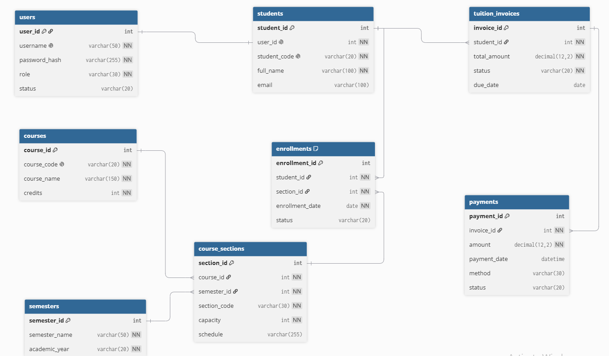
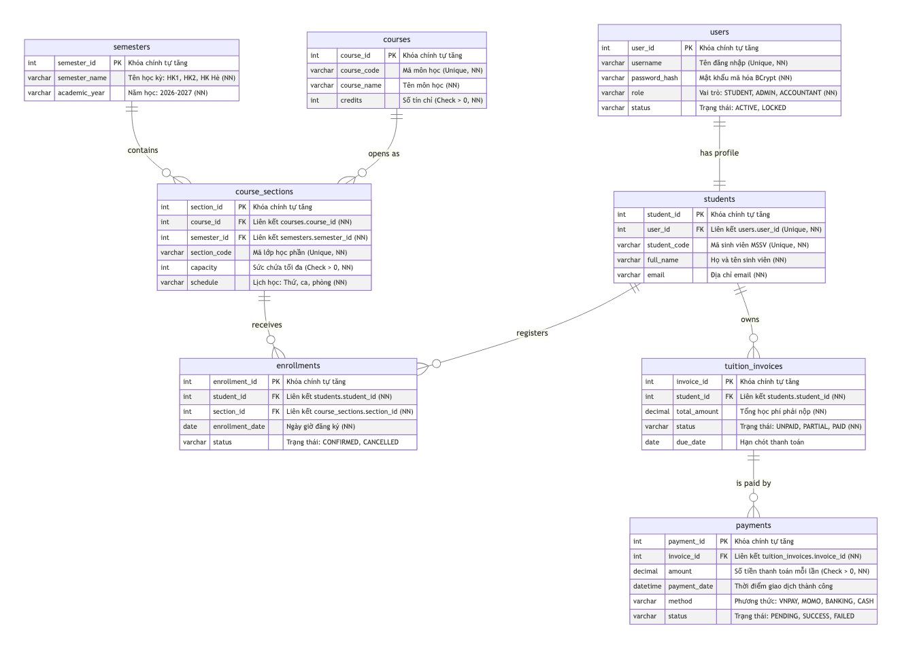

# Thiết kế cơ sở dữ liệu

> Trích từ báo cáo thiết kế Buổi 6 (Lab06) – Nhóm Ba Anh Tài.

### 3.1. Xác định các thực thể
Dựa trên phân tích yêu cầu bài toán quản lý đăng ký môn học và thu học phí, kết hợp chuẩn hóa dữ liệu từ mô hình lớp (Class Diagram) ở Tuần 5, hệ thống xác định **8 thực thể dữ liệu cốt lõi** trong cơ sở dữ liệu quan hệ:

| STT | Tên bảng (Table Name) | Chức năng & Vai trò trong hệ thống |
| :---: | :--- | :--- |
| **1** | `users` | Lưu trữ thông tin tài khoản đăng nhập của toàn bộ người dùng trong hệ thống (sinh viên, giảng viên, nhân viên đào tạo, kế toán), mật khẩu băm bảo mật (Password Hash), vai trò phân quyền (Role) và trạng thái tài khoản. |
| **2** | `students` | Lưu trữ thông tin hồ sơ sinh viên: mã số sinh viên (MSSV), họ và tên, email liên lạc, ngành học; liên kết 1-1 với tài khoản đăng nhập tại bảng `users`. |
| **3** | `courses` | Lưu trữ danh mục các môn học thuộc chương trình đào tạo của nhà trường: mã môn học, tên môn học và số lượng tín chỉ. |
| **4** | `semesters` | Lưu trữ danh mục các học kỳ và năm học tương ứng (ví dụ: Học kỳ 1 năm học 2026 - 2027), xác định khung thời gian đào tạo của nhà trường. |
| **5** | `course_sections` | Lưu trữ danh sách các lớp học phần cụ thể được mở trong từng học kỳ của môn học: mã lớp học phần, phòng học, thứ, ca học, sức chứa tối đa (capacity). |
| **6** | `enrollments` | Lưu trữ thông tin kết quả đăng ký học phần của sinh viên: liên kết giữa sinh viên và lớp học phần, ngày giờ đăng ký, và trạng thái đăng ký. |
| **7** | `tuition_invoices` | Lưu trữ các hóa đơn học phí phát sinh của sinh viên theo từng học kỳ: tổng số tiền học phí phải nộp, trạng thái thanh toán (Chưa nộp, Đã nộp một phần, Hoàn tất) và ngày hết hạn nộp. |
| **8** | `payments` | Lưu trữ lịch sử chi tiết các giao dịch thanh toán học phí của sinh viên ứng với từng hóa đơn: số tiền nộp, ngày giờ giao dịch, phương thức thanh toán và trạng thái giao dịch. |

---

### 3.2. Sơ đồ ERD (Entity Relationship Diagram)

#### 3.2.1. Hình ảnh sơ đồ ERD trực quan
Dưới đây là sơ đồ thiết kế cơ sở dữ liệu quan hệ chi tiết được thiết kế theo chuẩn dbdiagram.io:

#### 3.2.2. Sơ đồ ERD thực thể quan hệ hoàn chỉnh

Dưới đây là hình ảnh sơ đồ ERD biểu diễn đầy đủ 8 thực thể và mối quan hệ ràng buộc trong cơ sở dữ liệu:

---

### 3.3. Mô tả các bảng dữ liệu
1. **Bảng `users`:** Quản lý trung tâm tài khoản đăng nhập. Tách riêng bảng `users` nhằm đảm bảo tính bảo mật, che giấu mật khẩu khỏi các nghiệp vụ quản lý sinh viên thông thường và phục vụ xác thực người dùng trên toàn hệ thống.
2. **Bảng `students`:** Chứa hồ sơ thông tin sinh viên phục vụ công tác quản lý đào tạo. Mỗi bản ghi trong `students` tương ứng duy nhất với 1 tài khoản đăng nhập ở bảng `users`.
3. **Bảng `courses`:** Danh mục môn học mang tính độc lập theo chương trình đào tạo, không phụ thuộc vào thời gian mở lớp.
4. **Bảng `semesters`:** Định nghĩa chu kỳ thời gian (học kỳ và niên khóa) để quản lý lớp học phần và hóa đơn học phí theo từng giai đoạn.
5. **Bảng `course_sections`:** Đại diện cho lớp học thực tế được mở ra trong một học kỳ. Bảng này mang thông tin sức chứa tối đa (`capacity`) và lịch học cụ thể.
6. **Bảng `enrollments`:** Bảng kết nối phân rã quan hệ nhiều - nhiều ($N-N$) giữa `students` và `course_sections`. Mỗi bản ghi xác nhận sinh viên đã đăng ký vào một lớp cụ thể.
7. **Bảng `tuition_invoices`:** Tổng hợp toàn bộ học phí sinh viên phải đóng trong học kỳ. Hóa đơn là căn cứ để theo dõi công nợ tài chính của sinh viên.
8. **Bảng `payments`:** Quản lý giao dịch thu tiền. Thiết kế bảng riêng cho phép hỗ trợ linh hoạt nghiệp vụ thanh toán phân kỳ (sinh viên có thể nộp học phí làm nhiều đợt cho cùng 1 hóa đơn).

---

### 3.4. Data Dictionary (Từ điển dữ liệu chi tiết)

Dưới đây là từ điển dữ liệu chuẩn hóa của 8 bảng, mô tả đầy đủ tên trường, kiểu dữ liệu, khóa, khả năng null, giá trị mặc định, ràng buộc và ý nghĩa nghiệp vụ:

#### 1. Bảng `users` (Tài khoản người dùng)
| Tên cột | Kiểu dữ liệu | Khóa | Nullable | Mặc định | Ràng buộc | Ý nghĩa nghiệp vụ |
| :--- | :--- | :---: | :---: | :---: | :--- | :--- |
| `user_id` | `INT` | **PK** | NOT NULL | AUTO_INCREMENT | Khóa chính | Mã định danh người dùng duy nhất |
| `username` | `VARCHAR(50)` | - | NOT NULL | - | UNIQUE | Tên đăng nhập hệ thống (Mã SV hoặc Tên tài khoản) |
| `password_hash` | `VARCHAR(255)` | - | NOT NULL | - | - | Mật khẩu đã mã hóa an toàn (BCrypt / Argon2) |
| `role` | `VARCHAR(30)` | - | NOT NULL | 'STUDENT' | CHECK (role IN ('STUDENT', 'ADMIN', 'ACCOUNTANT')) | Vai trò của tài khoản trong hệ thống |
| `status` | `VARCHAR(20)` | - | NOT NULL | 'ACTIVE' | CHECK (status IN ('ACTIVE', 'LOCKED', 'INACTIVE')) | Trạng thái hoạt động của tài khoản |

#### 2. Bảng `students` (Hồ sơ sinh viên)
| Tên cột | Kiểu dữ liệu | Khóa | Nullable | Mặc định | Ràng buộc | Ý nghĩa nghiệp vụ |
| :--- | :--- | :---: | :---: | :---: | :--- | :--- |
| `student_id` | `INT` | **PK** | NOT NULL | AUTO_INCREMENT | Khóa chính | Mã định danh nội bộ sinh viên |
| `user_id` | `INT` | **FK** | NOT NULL | - | UNIQUE, REFERENCES users(user_id) | Liên kết 1-1 với tài khoản người dùng |
| `student_code` | `VARCHAR(20)` | - | NOT NULL | - | UNIQUE | Mã số sinh viên chính thức (Ví dụ: 52400261) |
| `full_name` | `VARCHAR(100)` | - | NOT NULL | - | - | Họ và tên đầy đủ của sinh viên |
| `email` | `VARCHAR(100)` | - | NULL | - | - | Địa chỉ email trường hoặc cá nhân |

#### 3. Bảng `courses` (Danh mục môn học)
| Tên cột | Kiểu dữ liệu | Khóa | Nullable | Mặc định | Ràng buộc | Ý nghĩa nghiệp vụ |
| :--- | :--- | :---: | :---: | :---: | :--- | :--- |
| `course_id` | `INT` | **PK** | NOT NULL | AUTO_INCREMENT | Khóa chính | Mã định danh môn học |
| `course_code` | `VARCHAR(20)` | - | NOT NULL | - | UNIQUE | Mã môn học chuẩn (Ví dụ: CS201, 502045) |
| `course_name` | `VARCHAR(150)` | - | NOT NULL | - | - | Tên môn học (Ví dụ: Công nghệ phần mềm) |
| `credits` | `INT` | - | NOT NULL | 3 | CHECK (credits > 0 AND credits <= 10) | Số lượng tín chỉ tích lũy của môn học |

#### 4. Bảng `semesters` (Danh mục học kỳ)
| Tên cột | Kiểu dữ liệu | Khóa | Nullable | Mặc định | Ràng buộc | Ý nghĩa nghiệp vụ |
| :--- | :--- | :---: | :---: | :---: | :--- | :--- |
| `semester_id` | `INT` | **PK** | NOT NULL | AUTO_INCREMENT | Khóa chính | Mã định danh học kỳ |
| `semester_name` | `VARCHAR(50)` | - | NOT NULL | - | - | Tên học kỳ (Ví dụ: Học kỳ 1, Học kỳ 2, Học kỳ Hè) |
| `academic_year` | `VARCHAR(20)` | - | NOT NULL | - | - | Niên khóa đào tạo (Ví dụ: 2026 - 2027) |

#### 5. Bảng `course_sections` (Lớp học phần mở)
| Tên cột | Kiểu dữ liệu | Khóa | Nullable | Mặc định | Ràng buộc | Ý nghĩa nghiệp vụ |
| :--- | :--- | :---: | :---: | :---: | :--- | :--- |
| `section_id` | `INT` | **PK** | NOT NULL | AUTO_INCREMENT | Khóa chính | Mã định danh lớp học phần |
| `course_id` | `INT` | **FK** | NOT NULL | - | REFERENCES courses(course_id) | Môn học được mở lớp |
| `semester_id` | `INT` | **FK** | NOT NULL | - | REFERENCES semesters(semester_id) | Học kỳ áp dụng mở lớp |
| `section_code` | `VARCHAR(30)` | - | NOT NULL | - | UNIQUE | Mã lớp học phần hiển thị (Ví dụ: CS201.01) |
| `capacity` | `INT` | - | NOT NULL | 60 | CHECK (capacity > 0) | Sức chứa tối đa của lớp học phần |
| `schedule` | `VARCHAR(255)` | - | NOT NULL | - | - | Lịch học (Thứ, Ca học, Phòng học cụ thể) |

#### 6. Bảng `enrollments` (Đăng ký học phần)
| Tên cột | Kiểu dữ liệu | Khóa | Nullable | Mặc định | Ràng buộc | Ý nghĩa nghiệp vụ |
| :--- | :--- | :---: | :---: | :---: | :--- | :--- |
| `enrollment_id` | `INT` | **PK** | NOT NULL | AUTO_INCREMENT | Khóa chính | Mã định danh giao dịch đăng ký |
| `student_id` | `INT` | **FK** | NOT NULL | - | REFERENCES students(student_id) | Sinh viên thực hiện đăng ký |
| `section_id` | `INT` | **FK** | NOT NULL | - | REFERENCES course_sections(section_id) | Lớp học phần được đăng ký |
| `enrollment_date` | `DATE` | - | NOT NULL | CURRENT_DATE | - | Ngày ghi nhận sinh viên đăng ký lớp |
| `status` | `VARCHAR(20)` | - | NOT NULL | 'CONFIRMED' | CHECK (status IN ('CONFIRMED', 'CANCELLED')) | Trạng thái đăng ký học phần |

#### 7. Bảng `tuition_invoices` (Hóa đơn học phí)
| Tên cột | Kiểu dữ liệu | Khóa | Nullable | Mặc định | Ràng buộc | Ý nghĩa nghiệp vụ |
| :--- | :--- | :---: | :---: | :---: | :--- | :--- |
| `invoice_id` | `INT` | **PK** | NOT NULL | AUTO_INCREMENT | Khóa chính | Mã định danh hóa đơn học phí |
| `student_id` | `INT` | **FK** | NOT NULL | - | REFERENCES students(student_id) | Sinh viên sở hữu hóa đơn học phí |
| `total_amount` | `DECIMAL(12,2)` | - | NOT NULL | 0.00 | CHECK (total_amount >= 0) | Tổng số tiền học phí phát sinh phải nộp (VNĐ) |
| `status` | `VARCHAR(20)` | - | NOT NULL | 'UNPAID' | CHECK (status IN ('UNPAID', 'PARTIAL', 'PAID')) | Trạng thái thanh toán công nợ |
| `due_date` | `DATE` | - | NULL | - | - | Hạn chót sinh viên phải hoàn thành học phí |

#### 8. Bảng `payments` (Lịch sử thanh toán học phí)
| Tên cột | Kiểu dữ liệu | Khóa | Nullable | Mặc định | Ràng buộc | Ý nghĩa nghiệp vụ |
| :--- | :--- | :---: | :---: | :---: | :--- | :--- |
| `payment_id` | `INT` | **PK** | NOT NULL | AUTO_INCREMENT | Khóa chính | Mã định danh giao dịch nộp tiền |
| `invoice_id` | `INT` | **FK** | NOT NULL | - | REFERENCES tuition_invoices(invoice_id) | Hóa đơn học phí được thanh toán |
| `amount` | `DECIMAL(12,2)` | - | NOT NULL | - | CHECK (amount > 0) | Số tiền thực hiện trong lần nộp này (VNĐ) |
| `payment_date` | `DATETIME` | - | NOT NULL | CURRENT_TIMESTAMP | - | Thời điểm giao dịch được ghi nhận thành công |
| `method` | `VARCHAR(30)` | - | NOT NULL | 'VNPAY' | CHECK (method IN ('VNPAY', 'MOMO', 'BANKING', 'CASH')) | Phương thức thanh toán được lựa chọn |
| `status` | `VARCHAR(20)` | - | NOT NULL | 'PENDING' | CHECK (status IN ('PENDING', 'SUCCESS', 'FAILED')) | Trạng thái xử lý của giao dịch thanh toán |

---

### 3.5. Khóa chính, khóa ngoại và ràng buộc dữ liệu

#### 3.5.1. Chiến lược Khóa chính (Primary Key - PK)
- Toàn bộ 8 bảng dữ liệu đều sử dụng **Khóa nhân tạo (Surrogate Key)** kiểu số nguyên tự tăng (`INT AUTO_INCREMENT` hoặc `BIGINT GENERATED ALWAYS AS IDENTITY`).
- **Lý do lựa chọn:**
  + Tối ưu hóa hiệu năng đánh chỉ mục B-Tree: Khóa số nguyên có kích thước cố định nhỏ gọn ($4$ hoặc $8$ bytes), giúp các trang chỉ mục (Index Pages) chứa được nhiều nút hơn, tăng tốc độ tìm kiếm và giảm dung lượng RAM sử dụng.
  + Tránh phụ thuộc vào dữ liệu nghiệp vụ: Nếu dùng mã sinh viên hoặc mã môn học làm khóa chính tự nhiên (Natural Key), khi quy chuẩn mã nghiệp vụ của nhà trường thay đổi, việc cập nhật khóa ngoại phân tán trên hàng triệu bản ghi sẽ cực kỳ tốn kém và rủi ro.

#### 3.5.2. Khóa ngoại và Toàn vẹn tham chiếu (Foreign Key & Referential Integrity)
- Mọi quan hệ giữa các bảng được thiết lập khóa ngoại tường minh (`FOREIGN KEY ... REFERENCES`).
- **Chiến lược toàn vẹn tham chiếu khi xóa (ON DELETE):**
  + Sử dụng quy tắc `ON DELETE RESTRICT` (hoặc `NO ACTION`) cho các mối quan hệ cha - con trọng yếu: Không cho phép xóa một môn học nếu đã có lớp học phần mở; không cho phép xóa một lớp học phần hoặc một sinh viên nếu đã có dữ liệu đăng ký (`enrollments`) hay hóa đơn học phí (`tuition_invoices`). Điều này bảo vệ dữ liệu lịch sử đào tạo và kế toán khỏi bị mất mát ngoài ý muốn.
  + Sử dụng `ON UPDATE CASCADE`: Khi khóa chính của thực thể cha được cập nhật, các khóa ngoại ở thực thể con tự động cập nhật đồng bộ.

#### 3.5.3. Ràng buộc duy nhất (Unique Constraints)
- **`UNIQUE (student_id, section_id)` trên bảng `enrollments`:** Đây là ràng buộc tối quan trọng ở cấp CSDL. Nó bảo đảm chắc chắn rằng mỗi sinh viên chỉ có thể ghi danh vào một lớp học phần cụ thể nhiều nhất một lần, ngăn chặn triệt để lỗi đăng ký trùng lặp (Duplicate Registration).
- **`UNIQUE (username)` trên `users`:** Mỗi tài khoản đăng nhập là duy nhất trên toàn trường.
- **`UNIQUE (student_code)` trên `students`:** Mỗi sinh viên chỉ có một mã số sinh viên duy nhất.
- **`UNIQUE (course_code)` trên `courses`:** Mã môn học không được phép trùng lặp trong chương trình đào tạo.
- **`UNIQUE (section_code)` trên `course_sections`:** Mã lớp học phần là duy nhất trong hệ thống.

#### 3.5.4. Ràng buộc kiểm tra miền giá trị (Check Constraints)
- `courses.credits > 0`: Số tín chỉ bắt buộc phải là số nguyên dương.
- `course_sections.capacity > 0`: Sức chứa của lớp học phần phải lớn hơn $0$.
- `tuition_invoices.total_amount >= 0`: Tổng học phí không được là số âm.
- `payments.amount > 0`: Số tiền thanh toán mỗi lần bắt buộc phải lớn hơn $0$.

---

### 3.6. Quan hệ giữa các bảng

1. **Quan hệ 1 – 1 giữa `users` và `students`:**
   - Mỗi người dùng đóng vai trò sinh viên có chính xác 1 bản ghi hồ sơ sinh viên tương ứng. Khóa ngoại `user_id` trong `students` được đặt ràng buộc `UNIQUE` để bảo đảm quan hệ $1-1$ chặt chẽ.
2. **Quan hệ 1 – N giữa `courses` và `course_sections`:**
   - Một môn học trong chương trình đào tạo có thể được mở thành nhiều lớp học phần khác nhau trong cùng một kỳ hoặc qua nhiều kỳ khác nhau ($1 - N$). Mỗi lớp học phần bắt buộc thuộc về đúng 1 môn học xác định.
3. **Quan hệ 1 – N giữa `semesters` và `course_sections`:**
   - Một học kỳ cụ thể chứa nhiều lớp học phần được tổ chức giảng dạy ($1 - N$).
4. **Quan hệ N – N giữa `students` và `course_sections` (thông qua bảng trung gian `enrollments`):**
   - Một sinh viên có thể đăng ký nhiều lớp học phần khác nhau trong kỳ; ngược lại, một lớp học phần tiếp nhận nhiều sinh viên tham gia học tập. Quan hệ $N-N$ này được giải quyết và chuẩn hóa thông qua bảng kết nối `enrollments`. Khóa chính `enrollment_id` kết hợp với cặp khóa ngoại `(student_id, section_id)` giúp ghi nhận chi tiết thời điểm và trạng thái của từng lượt đăng ký.
5. **Quan hệ 1 – N giữa `students` và `tuition_invoices`:**
   - Mỗi sinh viên trong suốt quá trình học tại trường sẽ có nhiều hóa đơn học phí tương ứng với từng học kỳ theo học ($1 - N$). Mỗi hóa đơn chỉ thuộc về đúng 1 sinh viên.
6. **Quan hệ 1 – N giữa `tuition_invoices` và `payments`:**
   - Một hóa đơn học phí có thể được chi trả thông qua nhiều lần giao dịch thanh toán khác nhau ($1 - N$) nếu sinh viên chọn hình thức nộp từng phần. Mỗi giao dịch thanh toán liên kết trực tiếp với duy nhất 1 hóa đơn học phí.

---

### 3.7. Đối chiếu ERD với Class Diagram Buổi 5

Thiết kế cơ sở dữ liệu quan hệ (ERD) ở Tuần 6 được kế thừa trực tiếp và chuẩn hóa từ Sơ đồ lớp (Class Diagram) ở Tuần 5. Quá trình chuyển đổi từ **Mô hình hướng đối tượng (Object Model)** sang **Mô hình dữ liệu quan hệ (Relational Model)** được phân tích chi tiết trong bảng đối chiếu sau:

| Thành phần Class Diagram (Buổi 5) | Bảng dữ liệu ERD (Buổi 6) | Bản chất kỹ thuật của quá trình chuyển đổi |
| :--- | :--- | :--- |
| **Lớp cha trừu tượng `NguoiDung` & Lớp con `SinhVien`** *(Quan hệ kế thừa Inheritance)* | **Tách thành 2 bảng: `users` và `students`** *(Liên kết qua FK `user_id` với ràng buộc UNIQUE)* | CSDL quan hệ không hỗ trợ cơ chế kế thừa đối tượng trực tiếp. Nhóm áp dụng kỹ thuật **Table-Per-Type (TPT)**: Tách riêng bảng `users` chứa thông tin tài khoản chung (username, password, role) và bảng `students` chứa thuộc tính nghiệp vụ đặc thù (student_code, full_name, email). Cách tiếp cận này giúp bảo mật tài khoản và tái sử dụng cho các vai trò khác (Giảng viên, Kế toán). |
| **Lớp `MonHoc`** | **Bảng `courses`** | Ánh xạ trực tiếp 1-1. Thuộc tính `maMon`, `tenMon`, `soTinChi` trở thành các cột `course_code`, `course_name`, `credits`. |
| **Lớp `LopHocPhan`** | **Bảng `course_sections`** | Ánh xạ trực tiếp. Khóa ngoại `course_id` được thêm vào để hiện thực hóa liên kết với môn học; bổ sung thêm `semester_id` để quản lý lớp theo từng học kỳ cụ thể. |
| **Lớp `PhieuDangKy` & Lớp `ChiTietDangKy`** *(Quan hệ cấu thành Composition)* | **Bảng `enrollments`** *(kết hợp `semesters`)* | Trong Class Diagram Buổi 5, `PhieuDangKy` đại diện cho một đợt đăng ký và `ChiTietDangKy` là từng dòng chọn lớp. Trong ERD, nhằm chuẩn hóa dữ liệu theo chuẩn **3NF**, nhóm gộp và làm phẳng cấu trúc này thành bảng giao dịch `enrollments` liên kết trực tiếp `(student_id, section_id)`, trong khi học kỳ được quản lý độc lập tại bảng `semesters`. Điều này giúp tối ưu hóa truy vấn SQL và đơn giản hóa thao tác thêm/xóa môn. |
| **Lớp `HoaDonHocPhi`** | **Bảng `tuition_invoices` và bảng `payments`** | Trong Buổi 5, `HoaDonHocPhi` chỉ quản lý tổng tiền và trạng thái chung. Trong thực tế triển khai CSDL ở Buổi 6, nhóm tách thêm bảng thực thể `payments` để ghi nhận lịch sử từng đợt chuyển tiền, giải quyết trọn vẹn nghiệp vụ thanh toán phân kỳ và tích hợp cổng thanh toán trực tuyến. |

---

### 3.8. Giải thích các quyết định thiết kế

#### 3.8.1. Cơ chế kiểm soát đồng thời và chống Race Condition (Over-Enrollment)
Trong giờ mở cổng đăng ký tín chỉ, hàng trăm sinh viên cùng lúc tranh chấp suất học cuối cùng của một lớp học phần. Nếu chỉ dùng câu lệnh kiểm tra thông thường (`SELECT current_enrolled` rồi sau đó `UPDATE`), sẽ xảy ra hiện tượng **Race Condition** (nhiều tiến trình cùng đọc ra sĩ số còn chỗ và cùng thực hiện ghi đè, dẫn đến sĩ số thực tế vượt quá sức chứa lớp).

Nhóm đưa ra 2 giải pháp kỹ thuật cấp CSDL để giải quyết triệt để vấn đề này:
1. **Giải pháp 1: Khóa bi quan (Pessimistic Locking với `SELECT ... FOR UPDATE`):**
   - Khi tiến trình đăng ký bắt đầu, hệ thống thực thi:
     $$\text{SELECT capacity, current\_enrolled FROM course\_sections WHERE section\_id = ? FOR UPDATE;}$$
   - Câu lệnh này đặt một khóa độc quyền (Exclusive Lock) lên hàng dữ liệu của lớp học phần. Mọi yêu cầu đăng ký khác vào lớp này bắt buộc phải xếp hàng chờ cho đến khi Transaction hiện tại hoàn tất (`COMMIT` hoặc `ROLLBACK`).
2. **Giải pháp 2: Atomic Conditional Update (Cập nhật có điều kiện nguyên tử):**
   - Tận dụng cơ chế khóa ngầm của RDBMS bằng câu lệnh cập nhật nguyên tử:
     $$\text{UPDATE course\_sections SET current\_enrolled = current\_enrolled + 1 WHERE section\_id = ? AND current\_enrolled < capacity;}$$
   - Nếu số hàng bị ảnh hưởng (Rows Affected) trả về bằng $1$, việc đăng ký thành công và tiến hành chèn vào bảng `enrollments`. Nếu Rows Affected bằng $0$, chứng tỏ lớp đã đầy tại thời điểm thực thi, hệ thống lập tức thông báo hết chỗ mà không bị nghẽn khóa hàng loạt.

#### 3.8.2. Chiến lược đánh chỉ mục (Indexing Strategy)
Để đảm bảo thời gian phản hồi dưới 1 giây trong điều kiện tải cao, nhóm thiết lập các chỉ mục B-Tree chuyên biệt:
- **Index trên các Khóa ngoại (Foreign Keys):** Tạo chỉ mục trên `student_id` và `section_id` của bảng `enrollments`, `course_id` của `course_sections`, `student_id` của `tuition_invoices`. Điều này giúp tối ưu hóa tối đa các thao tác `JOIN` bảng khi tra cứu thời khóa biểu và công nợ.
- **Index tìm kiếm nghiệp vụ:** Tạo chỉ mục trên `(course_id, semester_id)` ở bảng `course_sections` để phục vụ nhanh chóng tính năng lọc danh sách môn học mở theo học kỳ.

---
