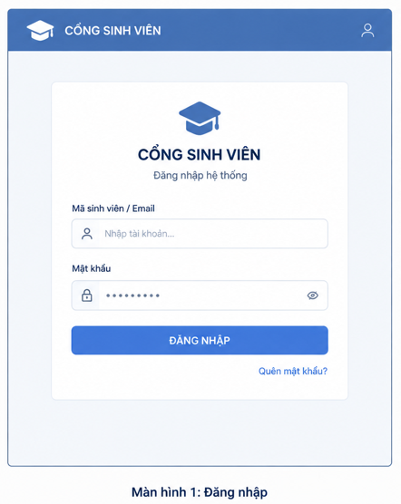
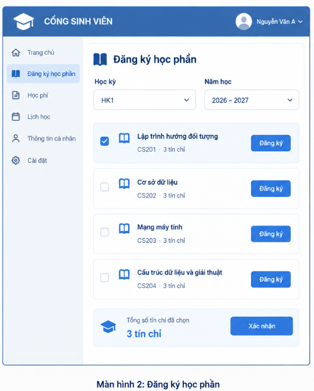
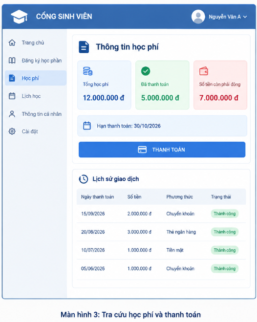

# Thiết kế giao diện

> Trích từ báo cáo thiết kế Buổi 6 (Lab06) – Nhóm Ba Anh Tài.

### 4.1. Danh sách màn hình và vai trò người dùng
Hệ thống được thiết kế theo chuẩn trải nghiệm người dùng hiện đại, trực quan, phục vụ toàn diện cho 3 nhóm đối tượng người dùng. Dưới đây là danh sách tổng hợp các màn hình giao diện cốt lõi cùng ma trận phân quyền:

| Mã MH | Tên màn hình giao diện | Đối tượng sử dụng | Mục đích nghiệp vụ chính |
| :---: | :--- | :--- | :--- |
| **MH01** | **Màn hình Đăng nhập (Login)** | Tất cả người dùng *(Sinh viên, Đào tạo, Kế toán)* | Xác thực định danh tài khoản, kiểm tra vai trò người dùng và điều hướng vào đúng phân hệ chức năng tương ứng. |
| **MH02** | **Màn hình Đăng ký học phần (Course Registration)** | Sinh viên | Cho phép sinh viên lọc học phần theo học kỳ, tra cứu các lớp học phần đang mở, kiểm tra sĩ số, chọn lớp và gửi yêu cầu đăng ký môn học. |
| **MH03** | **Màn hình Kết quả đăng ký & Thời khóa biểu (Registration Results & Schedule)** | Sinh viên | Hiển thị danh sách các lớp học phần đã đăng ký thành công trong kỳ, tổng số tín chỉ tích lũy, lưới thời khóa biểu trực quan và chức năng hủy môn đã đăng ký. |
| **MH04** | **Màn hình Tra cứu học phí & Thanh toán (Tuition & Payment)** | Sinh viên | Hiển thị bảng tổng hợp tài chính (tổng học phí, số tiền đã nộp, số tiền còn nợ), cảnh báo hạn nộp, thực hiện thanh toán trực tuyến và tra cứu lịch sử giao dịch. |
| **MH05** | **Màn hình Quản lý môn học & Lớp học phần (Course & Section Management)** | Cán bộ Phòng Đào tạo / Admin | Quản lý danh mục môn học, kế hoạch mở các lớp học phần theo học kỳ, thiết lập sức chứa tối đa, xếp lịch học, phân công giảng viên và đóng/mở đợt đăng ký. |
| **MH06** | **Màn hình Quản lý hóa đơn & Xác nhận thanh toán (Invoice & Payment Management)** | Nhân viên Kế toán / Tài vụ | Tra cứu công nợ sinh viên theo MSSV, quản lý danh sách hóa đơn học phí, ghi nhận thanh toán trực tiếp tại quầy và đối soát giao dịch ngân hàng. |

---

### 4.2. Wireframe màn hình đăng nhập (MH01)

#### 4.2.1. Hình ảnh trực quan Wireframe
Dưới đây là giao diện màn hình Đăng nhập được thiết kế chuẩn mực:



#### 4.2.2. Bố cục khối chi tiết (Text/ASCII Wireframe Layout)
```
+-----------------------------------------------------------------------+
|  [icon] CỔNG THÔNG TIN SINH VIÊN                          [User Icon] |
+-----------------------------------------------------------------------+
|                                                                       |
|                     +---------------------------+                     |
|                     |       [Logo Trường]       |                     |
|                     |      CỔNG SINH VIÊN       |                     |
|                     |     Đăng nhập hệ thống    |                     |
|                     |                           |                     |
|                     | Mã sinh viên / Email      |                     |
|                     | [ 👤 Nhập tài khoản...  ] |                     |
|                     |                           |                     |
|                     | Mật khẩu                  |                     |
|                     | [ 🔒 ••••••••••        👁 ] |                     |
|                     |                           |                     |
|                     | +-----------------------+ |                     |
|                     | |       ĐĂNG NHẬP       | |                     |
|                     | +-----------------------+ |                     |
|                     |                           |                     |
|                     |            Quên mật khẩu? |                     |
|                     +---------------------------+                     |
|                                                                       |
+-----------------------------------------------------------------------+
```

#### 4.2.3. Thuyết minh thành phần giao diện
- **Thanh tiêu đề (Header):** Hiển thị logo nhận diện thương hiệu cổng sinh viên trường Đại học Tôn Đức Thắng.
- **Khung đăng nhập trung tâm (Card Panel):** Bố trí cân đối giữa màn hình giúp người dùng tập trung thao tác.
  + Ô nhập tài khoản: Cho phép đăng nhập bằng Mã số sinh viên (đối với sinh viên) hoặc Tên tài khoản / Email trường (đối với cán bộ quản lý).
  + Ô nhập mật khẩu: Ẩn ký tự dưới dạng dấu chấm bảo mật kèm nút bấm biểu tượng con mắt để bật/tắt hiển thị mật khẩu khi cần kiểm tra.
  + Nút chức năng "ĐĂNG NHẬP": Kích hoạt sự kiện gửi dữ liệu xác thực xuống máy chủ.
  + Liên kết "Quên mật khẩu?": Hỗ trợ sinh viên khôi phục mật khẩu qua email sinh viên khi gặp sự cố.

---

### 4.3. Wireframe màn hình đăng ký học phần (MH02)

#### 4.3.1. Hình ảnh trực quan Wireframe
Dưới đây là giao diện màn hình Đăng ký học phần:



#### 4.3.2. Bố cục khối chi tiết (Text/ASCII Wireframe Layout)
```
+-----------------------------------------------------------------------+
| [icon] CỔNG SINH VIÊN                     [Avatar] Nguyễn Văn A (SV) ▾|
+-------------------+---------------------------------------------------+
| 🏠 Trang chủ       | 📖 ĐĂNG KÝ HỌC PHẦN                               |
|                   |                                                   |
| 📖 Đăng ký học phần| Học kỳ: [ HK1        ▾ ]   Năm học: [ 2026-2027 ▾ ]|
|                   | ------------------------------------------------- |
| 💳 Học phí        | [✓] 📖 Lập trình hướng đối tượng                  |
|                   |        CS201 · 3 tín chỉ          [  Đăng ký   ]  |
| 📅 Lịch học       |                                                   |
|                   | [ ] 📖 Cơ sở dữ liệu                              |
| 👤 Thông tin cá nhân|      CS202 · 3 tín chỉ          [  Đăng ký   ]  |
|                   |                                                   |
| ⚙ Cài đặt         | [ ] 📖 Mạng máy tính                              |
|                   |        CS203 · 3 tín chỉ          [  Đăng ký   ]  |
|                   |                                                   |
|                   | [ ] 📖 Cấu trúc dữ liệu và giải thuật             |
|                   |        CS204 · 3 tín chỉ          [  Đăng ký   ]  |
|                   | ------------------------------------------------- |
|                   |  [icon] Tổng số tín chỉ đã chọn:   +------------+ |
|                   |         3 tín chỉ                  |  XÁC NHẬN  | |
|                   |                                    +------------+ |
+-------------------+---------------------------------------------------+
```

#### 4.3.3. Thuyết minh thành phần giao diện
- **Thanh điều hướng bên trái (Sidebar Navigation):** Cho phép sinh viên di chuyển nhanh chóng giữa các phân hệ: Trang chủ, Đăng ký học phần, Học phí, Lịch học, Thông tin cá nhân và Cài đặt.
- **Khu vực bộ lọc (Filter Area):** Cho phép chọn nhanh Học kỳ (`HK1`, `HK2`, `HK Hè`) và Năm học (`2026-2027`) để tải chính xác danh mục các lớp học phần được mở trong kỳ.
- **Danh sách học phần (Course Cards List):** Mỗi môn học hiển thị dưới dạng thẻ thông tin trực quan:
  + Tên môn học, Mã môn học và Số tín chỉ tương ứng.
  + Hộp kiểm (Checkbox) để đánh dấu chọn môn.
  + Nút "Đăng ký": Nhấn để mở rộng danh sách các lớp học phần cụ thể của môn đó kèm thông tin phòng học, ca học và sĩ số hiện tại.
- **Thanh tổng kết dưới cùng (Sticky Footer):** Hiển thị biểu tượng nón tốt nghiệp, tổng số tín chỉ sinh viên đã tích lũy trong kỳ hiện tại và nút **"XÁC NHẬN"** để hoàn tất toàn bộ phiếu đăng ký.

---

### 4.4. Wireframe màn hình kết quả đăng ký & thời khóa biểu (MH03)

#### 4.4.1. Bố cục khối chi tiết (Text/ASCII Wireframe Layout)
```
+-----------------------------------------------------------------------+
| [icon] CỔNG SINH VIÊN                     [Avatar] Nguyễn Văn A (SV) ▾|
+-------------------+---------------------------------------------------+
| 🏠 Trang chủ       | 📋 KẾT QUẢ ĐĂNG KÝ HỌC PHẦN & THỜI KHÓA BIỂU      |
|                   | Học kỳ 1 - Năm học 2026-2027                      |
| 📖 Đăng ký học phần|                                                   |
|                   | [ In Thời Khóa Biểu ]       [ Xuất File Excel ]   |
| 📅 Lịch học (Active)| ------------------------------------------------ |
|                   | DANH SÁCH LỚP HỌC PHẦN ĐÃ ĐĂNG KÝ THÀNH CÔNG:     |
| 💳 Học phí        | +---------+--------------------+----+------+----+--+
|                   | | Mã LHP  | Tên môn học        | TC | Lịch |Phòng| Thao tác |
| 👤 Thông tin cá nhân| +---------+--------------------+----+------+----+--+
|                   | |CS201.01 | Lập trình HĐT      | 3  |T2 C1-3|B204 |[Hủy môn]|
| ⚙ Cài đặt         | |CS202.03 | Cơ sở dữ liệu      | 3  |T4 C4-6|C102 |[Hủy môn]|
|                   | |CS203.02 | Mạng máy tính      | 3  |T6 C7-9|A301 |[Hủy môn]|
|                   | +---------+--------------------+----+------+----+--+
|                   | * Tổng số tín chỉ hợp lệ đã đăng ký: 9 tín chỉ    |
|                   | * Trạng thái đợt đăng ký: ĐANG MỞ (Còn hạn hủy)   |
|                   |                                                   |
|                   | 📅 LƯỚI THỜI KHÓA BIỂU TUẦN TRỰC QUAN:           |
|                   | +-------+--------+--------+--------+--------+-----+
|                   | | Ca/Thứ| Thứ 2  | Thứ 3  | Thứ 4  | Thứ 5  |Thứ 6|
|                   | +-------+--------+--------+--------+--------+-----+
|                   | | Ca 1-3| CS201  |        |        |        |     |
|                   | | Ca 4-6|        |        | CS202  |        |     |
|                   | | Ca 7-9|        |        |        |        |CS203|
|                   | +-------+--------+--------+--------+--------+-----+
+-------------------+---------------------------------------------------+
```

#### 4.4.2. Thuyết minh thành phần giao diện
- **Danh sách lớp học phần đã ghi nhận:** Bảng dữ liệu chi tiết hiển thị mã lớp, tên môn học, số tín chỉ, lịch học (thứ/ca), phòng học và nút thao tác màu đỏ **[Hủy môn]**.
- **Tính năng Hủy học phần:** Cho phép sinh viên rút bớt môn học trong thời gian quy định; khi nhấn nút, hệ thống hiển thị hộp thoại xác nhận (Confirm Dialog), sau đó tự động giải phóng vị trí trong lớp học phần và tính toán lại công nợ học phí.
- **Lưới thời khóa biểu trực quan (Weekly Timetable Grid):** Biểu diễn các ca học trực quan theo ma trận Thứ (Thứ 2 đến Thứ 7) và Ca học trong ngày, giúp sinh viên phát hiện nhanh các khoảng thời gian trống và tránh bị xung đột lịch sinh hoạt.
- **Nút tiện ích:** Hỗ trợ in trực tiếp hoặc xuất file Excel/PDF để sinh viên lưu trữ phục vụ việc học tập.

---

### 4.5. Wireframe màn hình học phí và thanh toán (MH04)

#### 4.5.1. Hình ảnh trực quan Wireframe
Dưới đây là giao diện màn hình Tra cứu học phí và thanh toán:



#### 4.5.2. Bố cục khối chi tiết (Text/ASCII Wireframe Layout)
```
+-----------------------------------------------------------------------+
| [icon] CỔNG SINH VIÊN                     [Avatar] Nguyễn Văn A (SV) ▾|
+-------------------+---------------------------------------------------+
| 🏠 Trang chủ       | 💳 THÔNG TIN HỌC PHÍ                              |
|                   |                                                   |
| 📖 Đăng ký học phần| +---------------+ +---------------+ +---------------+ |
|                   | | [icon tiền]   | | [icon tích]   | | [icon ví]     | |
| 💳 Học phí (Active)| | Tổng học phí  | | Đã thanh toán | | Còn phải đóng | |
|                   | | 12.000.000 đ  | | 5.000.000 đ   | | 7.000.000 đ   | |
| 📅 Lịch học       | +---------------+ +---------------+ +---------------+ |
|                   |                                                   |
| 👤 Thông tin cá nhân| [icon lịch] Hạn thanh toán: 30/10/2026          |
|                   |                                                   |
| ⚙ Cài đặt         | +-----------------------------------------------+ |
|                   | |               💳  THANH TOÁN                   | |
|                   | +-----------------------------------------------+ |
|                   |                                                   |
|                   | 🕒 Lịch sử giao dịch                              |
|                   | +------------+-------------+---------------+-----+|
|                   | |Ngày T.Toán | Số tiền     | Phương thức   |T.Thái||
|                   | +------------+-------------+---------------+-----+|
|                   | | 15/09/2026 | 2.000.000 đ | Chuyển khoản  |[T.C] ||
|                   | | 20/08/2026 | 3.000.000 đ | Thẻ ngân hàng |[T.C] ||
|                   | | 10/07/2026 | 1.000.000 đ | Tiền mặt      |[T.C] ||
|                   | | 05/06/2026 | 1.000.000 đ | Chuyển khoản  |[T.C] ||
|                   | +------------+-------------+---------------+-----+|
+-------------------+---------------------------------------------------+
```

#### 4.5.3. Thuyết minh thành phần giao diện
- **Ba thẻ thống kê tài chính trực quan (Overview Metric Cards):**
  + *Thẻ Xanh Dương:* Tổng học phí phát sinh trong học kỳ (Ví dụ: `12.000.000 đ`).
  + *Thẻ Xanh Lá Cây:* Tổng số tiền sinh viên đã thanh toán thành công (Ví dụ: `5.000.000 đ`).
  + *Thẻ Đỏ Cảnh Báo:* Số dư công nợ còn phải nộp (Ví dụ: `7.000.000 đ`).
- **Thanh thông tin hạn chót đóng phí:** Cảnh báo ngày hết hạn thanh toán (`30/10/2026`) bằng màu sắc nổi bật để nhắc nhở sinh viên hoàn thành đúng thời hạn.
- **Nút hành động chính "THANH TOÁN":** Nút kích thước lớn màu xanh nổi bật, cho phép sinh viên nhấn vào để chọn phương thức thanh toán trực tuyến qua cổng VNPay, MoMo hoặc tạo mã VietQR động để quét trên App ngân hàng.
- **Bảng lịch sử giao dịch (Transaction History Table):** Liệt kê chi tiết toàn bộ các lần nộp học phí trước đó, bao gồm ngày thanh toán, số tiền, hình thức (Chuyển khoản, Thẻ, Tiền mặt) và nhãn trạng thái xanh lục `Thành công`.

---

### 4.6. Wireframe màn hình quản lý dành cho nhân viên (MH05 & MH06)

#### 4.6.1. Màn hình Quản lý môn học & Lớp học phần dành cho Phòng Đào tạo (MH05)
```
+-----------------------------------------------------------------------+
| [icon] HỆ THỐNG QUẢN TRỊ ĐÀO TẠO            [Admin] Trần Quản Trị (P.ĐT)▾|
+-------------------+---------------------------------------------------+
| 📊 Báo cáo chung  | 🏢 QUẢN LÝ LỚP HỌC PHẦN THEO HỌC KỲ              |
|                   | Học kỳ: [ HK1 ▾ ]  Năm: [ 2026-2027 ▾ ]           |
| 📚 Quản lý môn học|                                                   |
|                   | [🔍 Nhập mã lớp / tên môn...]    [+ Mở Lớp Học Phần] |
| 🏫 Lớp học phần   | ------------------------------------------------- |
|   (Active)        | DANH SÁCH LỚP HỌC PHẦN ĐANG MỞ:                   |
| 👥 Quản lý SV     | +---------+---------------+----+-----+------+----+|
|                   | | Mã LHP  | Tên môn học   | TC |Sĩ Số|Lịch/P|T.Thái||
| ⏰ Đợt đăng ký    | +---------+---------------+----+-----+------+----+|
|                   | |CS201.01 |Lập trình HĐT  | 3  |60/60|T2-C1 |ĐẦY  ||
|                   | |CS201.02 |Lập trình HĐT  | 3  |45/60|T4-C4 |MỞ   ||
|                   | |CS202.01 |Cơ sở dữ liệu  | 3  |58/60|T6-C7 |MỞ   ||
|                   | +---------+---------------+----+-----+------+----+|
|                   | Thao tác trên lớp: [Sửa sĩ số] [Đổi phòng] [Hủy lớp]|
+-------------------+---------------------------------------------------+
```

#### 4.6.2. Màn hình Quản lý hóa đơn & Xác nhận thanh toán dành cho Kế toán (MH06)
```
+-----------------------------------------------------------------------+
| [icon] PHÂN HỆ TÀI CHÍNH - KẾ TOÁN          [User] Lê Kế Toán (P.KếToán)▾|
+-------------------+---------------------------------------------------+
| 📊 Tổng quan thu  | 💰 QUẢN LÝ HÓA ĐƠN VÀ ĐỐI SOÁT HỌC PHÍ            |
|                   | Học kỳ: [ HK1 ▾ ]   Năm học: [ 2026-2027 ▾ ]      |
| 📋 Hóa đơn học phí|                                                   |
|   (Active)        | [ 🔍 Nhập MSSV / Họ tên...]     [ Bộ lọc: Còn Nợ ▾ ] |
| 💳 Đối soát GD    | ------------------------------------------------- |
|                   | +--------+------------+-----------+-----------+---+
| 📑 Báo cáo nợ     | | MSSV   | Họ và tên  |Tổng họcphí| Còn nợ    |T.T|
|                   | +--------+------------+-----------+-----------+---+
| ⚙ Cấu hình định mức| |52400261|Lê Trọng D  |12.000.000 | 7.000.000 |NỢ |
|                   | |52400265|Đỗ Quang H  |10.500.000 |         0 |ĐỦ |
|                   | |52400082|Trần Gia M  |13.500.000 | 4.500.000 |NỢ |
|                   | +--------+------------+-----------+-----------+---+
|                   | [Thu tiền mặt tại quầy]  [Xuất Báo Cáo Công Nợ]   |
+-------------------+---------------------------------------------------+
```

---

### 4.7. Mô tả thao tác, dữ liệu nhập và phản hồi của hệ thống

Bảng dưới đây mô tả chi tiết các tương tác nghiệp vụ, trường dữ liệu nhập, quy tắc kiểm tra (Validation) và cách phản hồi của hệ thống trên từng màn hình:

| Màn hình | Tác nhân (Actor) | Mục đích nghiệp vụ | Trường dữ liệu & Validation | Nút chức năng | Phản hồi khi thành công | Phản hồi khi thất bại / Ngoại lệ |
| :--- | :--- | :--- | :--- | :--- | :--- | :--- |
| **MH01: Đăng nhập** | Sinh viên / Cán bộ | Xác thực truy cập hệ thống | • Tài khoản: Không để trống, định dạng MSSV hoặc email hợp lệ.<br>• Mật khẩu: Độ dài $\ge 6$ ký tự. | `[ĐĂNG NHẬP]`<br>`[Quên mật khẩu]` | Lưu JWT Token vào LocalStorage, chuyển hướng người dùng đến trang chủ phù hợp với quyền (Role). | Hiển thị thông báo đỏ: *"Tên đăng nhập hoặc mật khẩu không chính xác!"*. Khóa tài khoản sau 5 lần nhập sai liên tiếp. |
| **MH02: Đăng ký học phần** | Sinh viên | Chọn môn học và lớp học phần | • Học kỳ, Năm học: Chọn từ danh sách thả xuống.<br>• Hộp kiểm môn học.<br>• Lớp học phần: Chọn từ danh sách mở. | `[Đăng ký]`<br>`[Xác nhận]` | Đổi màu nút sang trạng thái đã chọn; tăng tổng số tín chỉ; hiển thị Toast: *"Đã thêm học phần thành công!"*. | Hiển thị hộp thoại lỗi cảnh báo cụ thể: *"Lớp học phần đã đầy"*, *"Trùng lịch với môn CS202"*, hoặc *"Chưa đạt môn tiên quyết CS101"*. |
| **MH03: Kết quả đăng ký** | Sinh viên | Xem TKB và quản lý môn đã chọn | • Không có trường nhập liệu mới (chế độ tra cứu).<br>• Chọn mã lớp muốn hủy. | `[Hủy môn]`<br>`[In TKB]`<br>`[Xuất Excel]` | Hiển thị hộp thoại xác nhận hủy; sau khi xác nhận, xóa môn khỏi danh sách, cập nhật lại sĩ số lớp và giảm số tín chỉ. | Báo lỗi nếu đã hết hạn đăng ký: *"Đợt đăng ký đã kết thúc, bạn không thể hủy môn học này!"*. |
| **MH04: Học phí & Thanh toán** | Sinh viên | Hoàn thành nghĩa vụ tài chính | • Chọn số tiền muốn nộp (Mặc định toàn bộ số nợ).<br>• Chọn cổng thanh toán: VNPay / MoMo / Thẻ ATM. | `[THANH TOÁN]` | Chuyển hướng trình duyệt an toàn sang cổng thanh toán; sau khi trả tiền, cập nhật trạng thái hóa đơn sang `PAID` và cập nhật lịch sử. | Hiển thị thông báo: *"Giao dịch thanh toán bị gián đoạn hoặc thất bại từ phía ngân hàng. Vui lòng thử lại!"*. |
| **MH05: Quản lý lớp HP** | Phòng Đào tạo | Tổ chức lớp học phần | • Mã môn, Học kỳ, Niên khóa.<br>• Sức chứa: Số nguyên $> 0$.<br>• Thứ, Ca, Phòng: Không được trùng phòng đã có lớp học. | `[+ Mở Lớp HP]`<br>`[Sửa sĩ số]`<br>`[Hủy lớp]` | Thêm lớp mới vào danh mục; cập nhật sĩ số tối đa; thông báo: *"Tạo lớp học phần thành công!"*. | Báo lỗi trùng phòng học: *"Phòng B204 đã có lớp CS201 học vào Thứ 2 Ca 1-3. Vui lòng chọn phòng khác!"*. |
| **MH06: Quản lý hóa đơn** | Kế toán | Quản lý thu học phí | • Tìm kiếm MSSV: Đúng định dạng số.<br>• Số tiền nộp tại quầy: Số tiền dương $\le$ Số tiền nợ. | `[Thu tiền mặt]`<br>`[Xuất Báo Cáo]` | Cập nhật số tiền còn nợ = 0, phát hành biên lai thu tiền điện tử, gửi email xác nhận cho sinh viên. | Báo lỗi: *"Số tiền nhập vượt quá tổng số nợ hiện tại của sinh viên!"*. |


---
